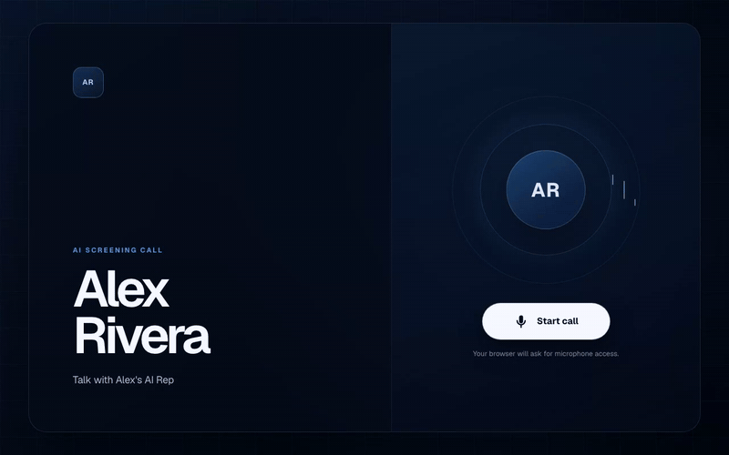
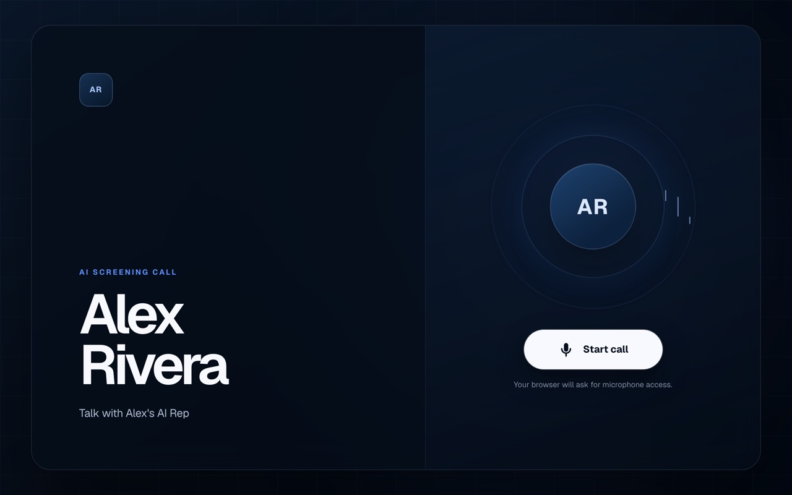
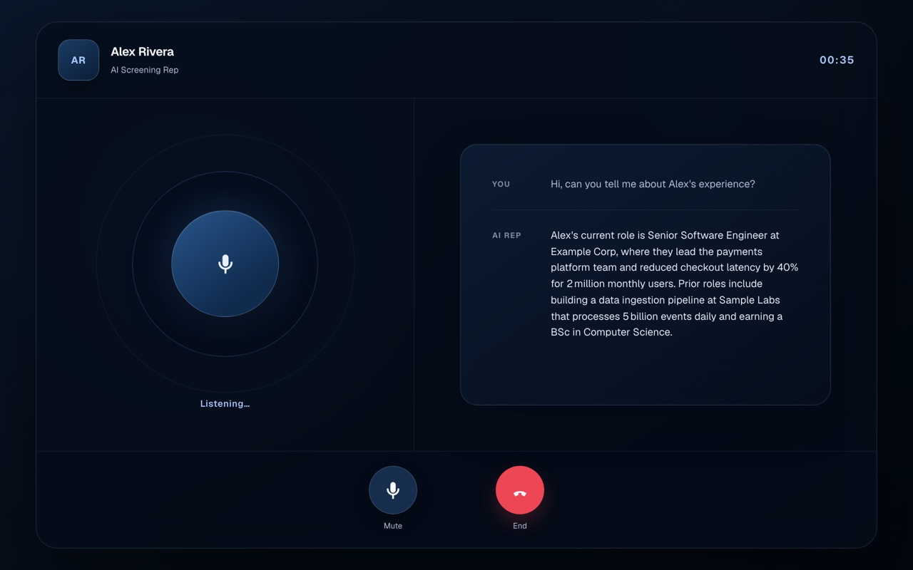

# HR Screening Voice Agent

An open-source AI rep that recruiters and hiring managers can call from the browser to screen
*you*. It answers only from the profile you give it, says when it doesn't know, discloses that
it's an AI, and points serious prospects to you. Python (FastAPI + Pydantic AI on Groq) behind a
Next.js call UI; speech is ElevenLabs.

<p align="center">
  
</p>

| Before the call | During the call |
| --- | --- |
|  |  |

## Quickstart

You need [git](https://git-scm.com), [uv](https://docs.astral.sh/uv/)
(`curl -LsSf https://astral.sh/uv/install.sh | sh`), [Node.js](https://nodejs.org) 22 or newer,
and two free API keys: [Groq](https://console.groq.com/keys) for the model and
[ElevenLabs](https://elevenlabs.io/app/settings/api-keys) for speech (with the text-to-speech
and speech-to-text permissions).

**1. Clone and configure**

```bash
git clone https://github.com/jlousada315/hr-screening-voice-agent.git  # privacy: allow
cd hr-screening-voice-agent
cp .env.example .env
```

Open `.env` and fill in `GROQ_API_KEY`, `ELEVENLABS_API_KEY` and `ELEVENLABS_VOICE_ID`. The
premade voice River (`SAz9YHcvj6GT2YYXdXww`) works on the free tier.

**2. Start the API** (leave this terminal running)

```bash
uv sync --all-packages
uv run --package hireme-api uvicorn app:app --reload --port 8000
```

**3. Start the UI** in a second terminal, from the same folder

```bash
cd web
npm ci
npm run dev
```

Open http://localhost:3000, click **Start call**, allow the microphone and ask a question.
The rep speaks for Alex Rivera, the fictional persona in `config/example.md`.

**4. Make it yours**

```bash
cp config/example.md config/owner.md      # then edit it: your name, roles and links
uv run python scripts/check_owner.py      # shows what the rep read
```

Restart both terminals to pick up the new profile.

`config/owner.md` is the rep's only source of facts about you: a `# Name` heading, an
`## Experience` list, a `## Links` list, and any other sections you like (About, Open to, FAQ),
which the rep quotes as your own words. Add `Pronouns:` or `Booking:` (a scheduling link; the
rep never reads your availability) under the name. It's gitignored so your details stay out of
commits; to deploy from a fork, add it with `git add -f config/owner.md` or mount it and set
`OWNER_FILE`. Without it, the rep runs as the fictional example persona and logs a warning. To
change how the rep behaves, edit `agent/src/hireme_agent/prompts/system.md`.

## Configuration

All settings live in the repository-root `.env` (see `.env.example`); real environment
variables take precedence.

| Variable | |
| --- | --- |
| `GROQ_API_KEY` | Required. From console.groq.com. |
| `LLM_MODEL`, `LLM_REASONING_EFFORT` | Groq model (default `groq/openai/gpt-oss-120b`) and gpt-oss effort (`low` default). |
| `ELEVENLABS_API_KEY`, `ELEVENLABS_VOICE_ID` | Required for the call UI; only the JSON text API (`POST /turn`) works without them. Use a neutral voice, not a clone of yours. |
| `NEXT_PUBLIC_API_URL`, `CORS_ORIGINS` | Where the UI finds the API, and which origins the API accepts. |
| `API_SHARED_SECRET` | Bearer token required on `/turn` and `/greeting`; set it when the API is public. |
| `OWNER_FILE` | Optional path to the owner file (default `config/owner.md`, then `config/example.md`). |
| `POSTHOG_API_KEY`, `POSTHOG_API_URL`, `DEPLOYMENT_ENVIRONMENT` | Optional LLM tracing and browser analytics. |
| `NEXT_PUBLIC_POSTHOG_FEEDBACK_*` | Optional end-of-call feedback survey (survey, rating and comment question IDs). |

## How it works

```
web/app/          call UI: voice activity detection, streamed turns, ordered audio playback
   │ POST /greeting, POST /turn   (Server-Sent Events)
api/app.py        auth, CORS, SSE; conversation_turn.py runs STT → agent → per-sentence TTS
agent/            prompt + owner profile tools, Pydantic AI → Groq, bounded in-memory history
```

Text turns stream tokens. Voice turns transcribe first, then synthesize each reply sentence as
soon as it lands, so audio starts after the first sentence. Conversations are in memory only.

## Tests

```bash
uv run pytest -q && uv run ruff check api agent        # offline; no keys needed
cd web && npm test && npx tsc --noEmit
RUN_INTEGRATION=1 uv run pytest -q -m integration      # live providers, costs credits
docker build -t hireme . && docker run --env-file .env -p 8000:8000 hireme
```

## Contributing

Issues and pull requests are welcome. Keep personal details out of code (they belong in the
owner file) and run the checks above before opening a PR.

Created by [João Lousada](https://github.com/jlousada315). <!-- privacy: allow -->
Licensed under [MIT](LICENSE).
