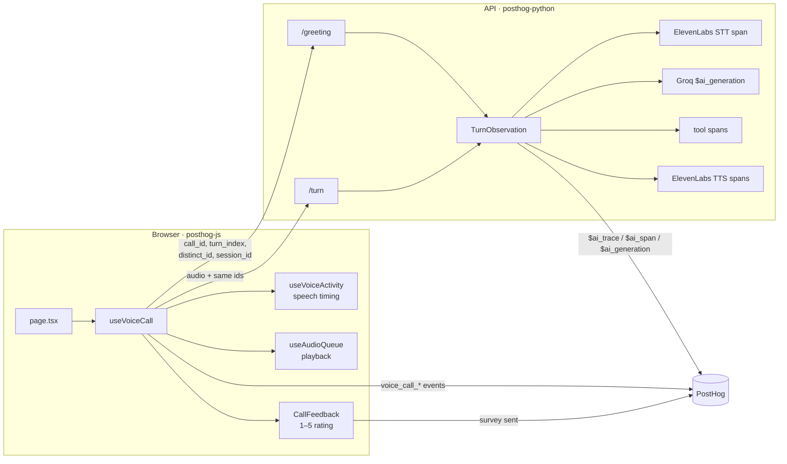
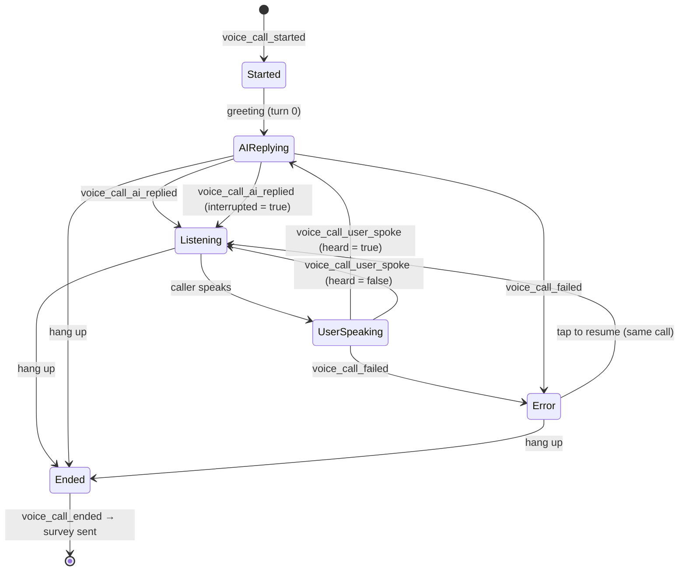
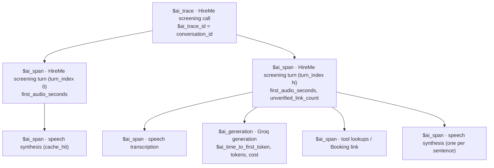
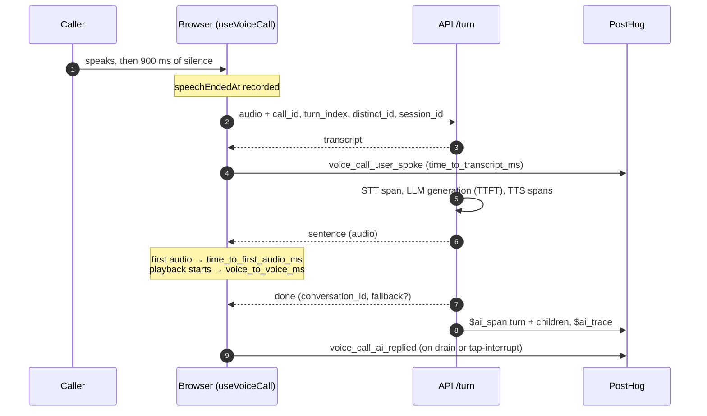

# Instrumentation

The product is a single thing: **one voice call with the AI rep**. The instrumentation exists to answer one question: *did the call go well?*

PostHog receives data from two places:

| Layer | SDK | What it records |
|---|---|---|
| Browser (`web/`) | `posthog-js` | The call as the caller experiences it: start, each turn, failures, the end, and the rating. |
| API and agent (`api/`, `agent/`) | `posthog` (Python) | LLM observability: one `$ai_trace` per call, with spans for each turn and for STT, the model, tools, and TTS. |

Both are optional. When `POSTHOG_API_KEY` is blank, nothing is sent. Analytics calls are wrapped so a failure never interrupts the call.

## Architecture



The ids that tie everything together:

| Key | Created by | On |
|---|---|---|
| `call_id` | browser, in `activate()` (`crypto.randomUUID()`) | every `voice_call_*` event, `survey sent`, and every `$ai_*` event |
| `conversation_id` | API, on the greeting | every event once known. It is also the `$ai_trace_id` (one trace per call) and the `$ai_session_id`. |
| `turn_index` | browser (the greeting is 0, then user turns count 1, 2, 3…) | progress events and the backend turn span |
| `distinct_id` / `$session_id` | posthog-js | browser events, and forwarded to the API so traces link to the person and the session replay |

## Tracking plan: start → progress → failure → end



### Events

| Stage | Event | Fires when |
|---|---|---|
| Start | `voice_call_started` | A new call begins. Resuming after an error is the same call and does not fire it again. |
| Progress | `voice_call_user_spoke` | The caller's utterance was transcribed (`heard: true`) or rejected as silence (`heard: false`). |
| Progress | `voice_call_ai_replied` | The AI reply finished playing, or the caller tapped to cut it short (`interrupted: true`). The greeting is turn 0. |
| Failure | `voice_call_failed` | Something went wrong (see the failure taxonomy below). |
| End | `voice_call_ended` | Hang-up, or the tab closing (sent with `sendBeacon`). It fires once per call and carries the summary. |
| End (final) | `survey sent` | The caller submits the 1–5 rating. It uses PostHog's survey format, so it shows in Surveys and on the call's LLM trace. |

### Properties

All `voice_call_*` events carry `call_id` and `conversation_id`. Browser events also carry the super properties `app_name: "hireme-web"` and `deployment_environment`.

**`voice_call_user_spoke`**

| Property | Meaning |
|---|---|
| `turn_index` | 1, 2, 3… |
| `heard` | `false` when the API returned 400 (nothing intelligible) |
| `speech_ms` | How long the caller spoke, as measured by the voice detector |
| `time_to_transcript_ms` | Upload → transcript received (`null` when not heard) |

**`voice_call_ai_replied`**

| Property | Meaning |
|---|---|
| `turn_index`, `is_greeting` | Which reply this was |
| `time_to_first_audio_ms` | Request sent → first sentence of audio received |
| `voice_to_voice_ms` | **The caller stopped speaking → the AI's audio started playing.** This is the latency the caller actually hears, including the 900 ms of end-of-speech silence detection. It is `null` for the greeting. |
| `reply_ms` | How long the reply was audible |
| `sentences`, `had_audio` | Reply size, and whether any audio came back |
| `fallback_reply` | The API spoke its "I'm busy" fallback because the model failed transiently |
| `interrupted`, `interrupted_after_ms` | The caller tapped to cut the reply short, and how long after the request that happened |

**`voice_call_failed`**

| Property | Meaning |
|---|---|
| `stage` | `connecting` (greeting), `user_speaking`, or `ai_replying` |
| `reason` | See the failure taxonomy below |
| `recoverable` | `true` when the call carried on by itself, `false` when the caller had to tap to resume |
| `http_status` | Present for HTTP failures |
| `turn_index` | The turn it happened on |

**`voice_call_ended`**

| Property | Meaning |
|---|---|
| `end_reason` | `hang_up`, `after_error` (hung up while in the error state), or `page_closed` |
| `duration_seconds` | Call length |
| `user_turns`, `user_turns_not_heard` | Caller turns, and how many weren't heard |
| `ai_replies`, `interruptions` | AI replies (including the greeting), and how many were cut short |
| `failures` | All `voice_call_failed` events in the call |
| `voice_to_voice_p50_ms`, `voice_to_voice_max_ms` | Latency summary for the call |
| `feedback_shown` | Whether the rating form was offered (the call had at least one answered turn and feedback is configured) |

**`survey sent`**

| Property | Meaning |
|---|---|
| `$survey_id`, `$survey_completed: true`, `$survey_submission_id` | PostHog survey fields |
| `$survey_response_<rating question id>` | 1–5 |
| `$survey_response_<comment question id>` | Free text, trimmed, at most 2,000 characters |
| `$ai_trace_id`, `$ai_session_id` | The `conversation_id`, which attaches the rating to the call's LLM trace |
| `call_id`, `conversation_id` | The call keys |

### Failure taxonomy

| `reason` | Stage | Source |
|---|---|---|
| `greeting_failed` | connecting | The `/greeting` request or stream failed. The call starts listening anyway (`recoverable: true`). |
| `playback_failed` | connecting / ai_replying | The browser refused to play audio. For the greeting this is often autoplay blocking, and the call carries on. |
| `mic_denied` | user_speaking | Microphone permission was denied or unavailable. |
| `mic_lost` | user_speaking | Recording failed mid-call. |
| `stt_failed` | user_speaking | `/turn` returned 502 (speech-to-text failed). |
| `network_error` | user_speaking / ai_replying | `fetch` failed. |
| `server_error` | user_speaking / ai_replying | `/turn` returned another non-2xx status. |
| `stream_ended` | user_speaking / ai_replying | The reply stream closed early or was malformed. |
| `reply_failed` | ai_replying | The API sent an `error` event (the model or TTS failed). Which provider failed is on the backend trace: join by `conversation_id`. |

### Interruptions

Today the caller can only interrupt by **tapping** while the rep is thinking or speaking. The microphone only listens in the `listening` phase, so talking over the rep isn't possible yet. When barge-in by voice is added, it should record `interrupted: true` the same way.

## Backend traces (LLM observability)



Every `$ai_*` event carries:
- `call_id`, `conversation_id`, `$ai_session_id`, `$session_id` (when the browser sent one)
- `interaction_mode`, `$ai_prompt_name`, `$ai_prompt_version`
- `deployment_environment`, `app_name: "hireme-agent"`
- `$ai_latency`, `$ai_is_error`

`$ai_time_to_first_token` is set at the model's first output part, whether that is text or a tool call, so turns that end in a tool or an output function (online presence, booking link) have it too.

Errors record the exception class, plus `$ai_http_status` and `$ai_retry_after_seconds` when available. They never record provider error bodies, which can contain secrets. A caller cancelling a turn records `$ai_cancelled` and is not counted as an error. Geo-IP lookup is disabled.

## A turn, end to end



## What counts as a good call

A call is **good** when all of these hold:
- `end_reason = hang_up`
- `ai_replies ≥ 3` (the greeting plus 2 answers)
- `failures = 0`
- `voice_to_voice_p50_ms ≤ 2000`
- the rating, when given, is ≥ 4

The thresholds live in PostHog, not in the client, so they can change without a deploy.

```sql
-- Share of good calls per day (HogQL)
SELECT
  toDate(e.timestamp) AS day,
  count() AS calls,
  countIf(
    e.properties.end_reason = 'hang_up'
    AND toInt(e.properties.ai_replies) >= 3
    AND toInt(e.properties.failures) = 0
    AND toFloat(e.properties.voice_to_voice_p50_ms) <= 2000
    AND coalesce(r.rating, 5) >= 4
  ) AS good_calls,
  round(good_calls / calls, 3) AS good_call_rate
FROM events AS e
LEFT JOIN (
  -- Replace <rating question id> with the survey's rating question id.
  SELECT properties.call_id AS call_id, toInt(properties['$survey_response_<rating question id>']) AS rating
  FROM events
  WHERE event = 'survey sent' AND timestamp > now() - INTERVAL 30 DAY
) AS r ON r.call_id = e.properties.call_id
WHERE e.event = 'voice_call_ended'
  AND e.timestamp > now() - INTERVAL 30 DAY
  AND e.properties.deployment_environment = 'production'
GROUP BY day
ORDER BY day
```

A **Call quality** dashboard built on these events should show:
- calls per day and the good-call rate
- the funnel `voice_call_started` → `voice_call_user_spoke` → `voice_call_ai_replied` (turn ≥ 2) → `voice_call_ended` (`hang_up`)
- p50/p95 `voice_to_voice_ms` and `$ai_time_to_first_token`
- `voice_call_failed` broken down by `reason` and `stage`
- interruptions per call
- the rating distribution and the latest comments

## Other capture settings

| Setting | Where | Notes |
|---|---|---|
| Pageviews, pageleaves, autocapture | `posthog.init` (`providers.tsx`) | Page context only. The app is a single page. |
| Web vitals | `capture_performance: { web_vitals: true }` | LCP, INP, CLS, FCP for the pre-call page. |
| Exceptions | `capture_exceptions: true` | Browser crashes go to Error Tracking. Backend exception autocapture stays off, because handled provider errors are already classified on spans and raw exception messages can carry provider bodies. |
| Session replay, console logs | PostHog project settings | Use these to watch a bad call: every event carries `$session_id`. |
| Environment | `DEPLOYMENT_ENVIRONMENT` | Sent on browser events (super property) and on `$ai_*` events. Filter on `production` in dashboards. |

## Privacy

- Product events never contain what the caller said or what the rep answered. That content lives only on `$ai_*` events (`$ai_input`, `$ai_output_choices`, input and output states), and PostHog keeps it for 30 days.
- Callers are anonymous: the app does not call `identify`. The only free text that leaves the browser through analytics is the optional feedback comment.
- When the user has opted out, feedback is never offered or sent.

## Configuration

| Variable | Purpose |
|---|---|
| `POSTHOG_API_KEY`, `POSTHOG_API_URL` | Turn on browser analytics and backend LLM tracing. Blank turns both off. |
| `DEPLOYMENT_ENVIRONMENT` | Tag events (`development` by default, `production` on deployed instances). |
| `NEXT_PUBLIC_POSTHOG_FEEDBACK_SURVEY_ID`, `…_RATING_QUESTION_ID`, `…_COMMENT_QUESTION_ID` | The end-of-call survey: a 1–5 rating question and an open-text question. All three are required, or the rating form is hidden. |

### Setting up the rating survey

The app renders its own rating form, so the PostHog survey is **headless**: an `api` survey, which never shows a popover. Create it once per PostHog project:

| Field | Value |
|---|---|
| Name | AI Rep call rating |
| Type | API (headless) |
| Question 1 | Rating, **scale 5**, display: number, required. "How was your call?" (labels Poor → Excellent) |
| Question 2 | Open text, optional. "Tell us more" |

Copy the survey id and the two question ids into `.env`:

```bash
NEXT_PUBLIC_POSTHOG_FEEDBACK_SURVEY_ID=<survey id>
NEXT_PUBLIC_POSTHOG_FEEDBACK_RATING_QUESTION_ID=<rating question id>
NEXT_PUBLIC_POSTHOG_FEEDBACK_COMMENT_QUESTION_ID=<open question id>
```

Responses then appear under the survey in PostHog and on each call's LLM trace (the Feedback tab), because `survey sent` carries `$ai_trace_id`. The question wording is already built into the app's form (`CallFeedbackForm.tsx`), so keep the two in sync if either changes.

A survey with a single-choice (thumbs) question doesn't work here: the app sends a number from 1 to 5 as the rating answer.

## Replaced events

These events are no longer sent. Their history stays in PostHog, and insights built on them need re-pointing for data after the switch.

| Old event | Replaced by |
|---|---|
| `voice_call_greeting_played` | `voice_call_ai_replied` with `is_greeting: true` |
| `chat_message_sent`, `voice_utterance_not_heard` | `voice_call_user_spoke` (`heard`) |
| `chat_reply_received` (`latency_ms`) | `voice_call_ai_replied` (`time_to_first_audio_ms`, `voice_to_voice_ms`) |
| `survey shown` | `feedback_shown` on `voice_call_ended` |
| `voice_call_feedback_linked` | `$ai_trace_id` on `survey sent` (one call = one trace) |
| `voice_utterance_captured` / `_discarded`, `voice_listening_idle`, `voice_listening_visibility` | not tracked: voice-detector diagnostics |
